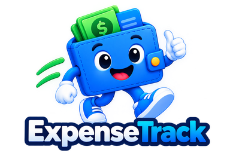
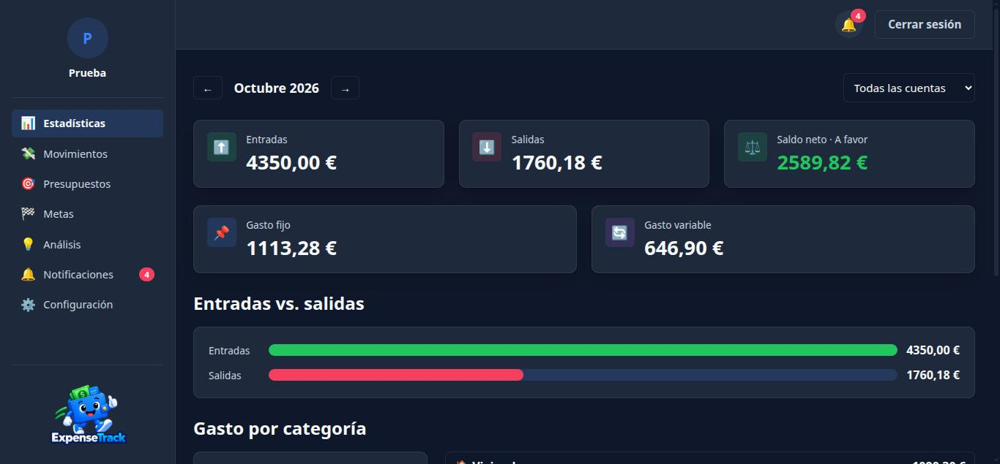
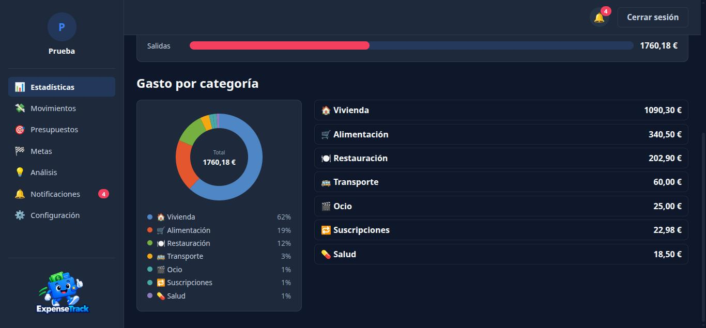
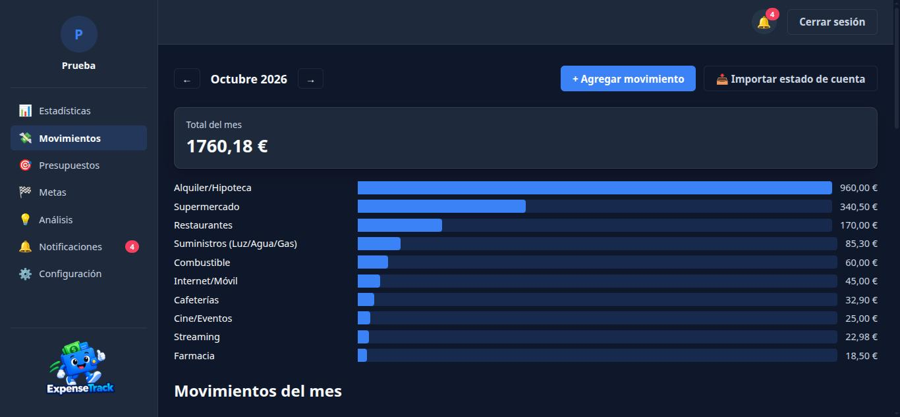
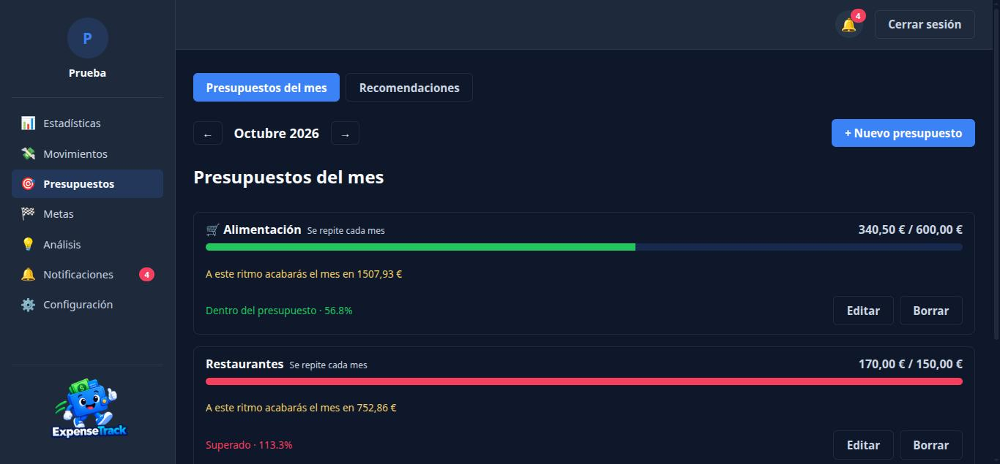
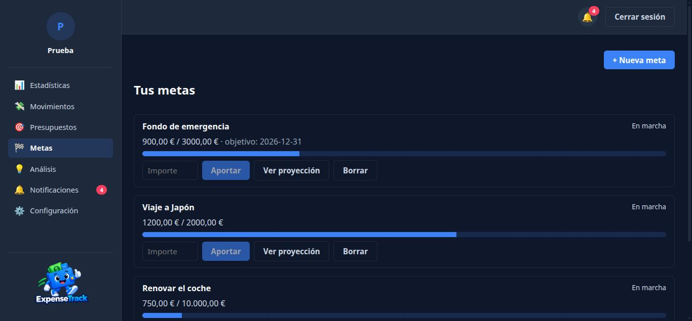

<p align="center">
  
</p>

<h1 align="center">ExpenseTrack</h1>

<p align="center">
  Aplicación web de finanzas personales: cuentas, movimientos, presupuestos mensuales, metas de ahorro y análisis del gasto.
</p>

<p align="center">
  
  
  
  
  
  
</p>

---

## ¿Qué es?

ExpenseTrack empezó como un registro de gastos y ha crecido hasta ser una
herramienta de finanzas personales. Es, a la vez, una herramienta de uso
diario y un **proyecto de aprendizaje de desarrollo asistido por IA**: cada
funcionalidad se planifica primero como una especificación (con
[OpenSpec](#cómo-se-trabaja-en-este-proyecto)) y después se implementa con
ayuda de un asistente de IA, con tests y documentación.

**Estado:** MVP funcional. Las mejoras futuras están apuntadas en
[`openspec/changes/`](openspec/changes/).

## Capturas

| Dashboard | Gasto por categoría |
|---|---|
|  |  |

| Movimientos | Presupuestos |
|---|---|
|  |  |

| Metas de ahorro |
|---|
|  |

## Funcionalidades

- **Cuentas y movimientos**: ingresos y gastos, con papelera de 30 días y adjuntos de recibos (imagen o PDF). Las transferencias entre cuentas ya están en la API, todavía sin pantalla.
- **Categorías de dos niveles** con un conjunto predefinido, más **reglas de categorización automática** (por ejemplo, "MERCADONA" → Supermercado).
- **Importación de extractos bancarios en CSV**: vista previa que detecta duplicados exactos y probables, y confirmación con tres estrategias que nunca tocan los movimientos manuales.
- **Presupuestos mensuales**: monto propio en cada mes, "repetir cada mes", edición de "solo este mes" o "este mes y los siguientes", meses pasados de solo lectura, ritmo de gasto ("a este ritmo acabarás en…"), copia del mes anterior y **recomendaciones de tope** a partir del historial.
- **Avisos** al 80% y al 100% de cada presupuesto, revisados al entrar a la app, y **resumen de cierre de mes**; en la app y por email.
- **Metas de ahorro** con aportaciones, progreso y proyección de la fecha en que se alcanzarán.
- **Dashboard mensual**: entradas, salidas, saldo neto, gasto fijo y variable y gasto por categoría, para todas las cuentas o una sola.
- **Análisis**: detección de pagos recurrentes y de "gasto hormiga" con umbrales configurables.
- **Autenticación** con email y contraseña o con Google, tokens de acceso de corta duración y refresh tokens rotativos.
- **API documentada en español** en `/docs` y `/redoc`, con su contrato versionado en [`backend/openapi.json`](backend/openapi.json).

## Tecnologías

| Capa | Tecnología |
|---|---|
| Frontend | React + TypeScript (Vite), React Router, TanStack Query |
| Backend | Python 3.12 + FastAPI, Pydantic |
| Base de datos | PostgreSQL 16, SQLAlchemy + Alembic |
| Autenticación | JWT, bcrypt, Google OAuth, refresh tokens |
| Tests | pytest (backend), Vitest + React Testing Library (frontend) |
| Calidad | Ruff, mypy, ESLint, Prettier |
| Entorno | Docker Compose (frontend, backend, base de datos y Mailhog para el email local) |
| Planificación | OpenSpec |

## Arquitectura

```
┌────────────────────┐   HTTP/JSON   ┌──────────────────────────┐   SQL   ┌──────────────┐
│ Frontend (React)   │ ────────────▶ │ Backend (FastAPI)        │ ──────▶ │ PostgreSQL   │
│ localhost:5173     │ ◀──────────── │ localhost:8000/api/v1    │         │              │
└────────────────────┘               │ routers → services →     │         └──────────────┘
                                     │ models / schemas         │ ──────▶ Mailhog (email local)
                                     └──────────────────────────┘
```

- **Backend** en capas: los `routers` reciben la petición, los `services` contienen la lógica de negocio y los `models`/`schemas` definen los datos y su validación.
- **Frontend** organizado por funcionalidad (`features/transactions`, `features/budgets`…), con TanStack Query para los datos del servidor.

## Cómo arrancarlo

Requisitos: [Docker](https://docs.docker.com/get-docker/) con Docker Compose.

```bash
git clone <url-del-repositorio>
cd ExpenseTrack
cp .env.example .env        # ajusta los valores si quieres; .env nunca se sube al repositorio
docker compose up --build
```

| Servicio | Dirección |
|---|---|
| Aplicación | http://localhost:5173 |
| Documentación de la API | http://localhost:8000/docs |
| Bandeja de email local (Mailhog) | http://localhost:8025 |

El login con Google es opcional: sin sus variables en `.env`, ese botón no funciona y el resto de la app sí.

### Datos de prueba

Para probar la app con varios meses de movimientos y algunas metas:

```bash
docker compose exec backend python -m scripts.seed_demo_data
```

Después entra con `demo.datos@example.com` / `demodatos1234`.

### Tests

```bash
docker compose exec backend pytest        # backend
docker compose exec frontend npm test     # frontend
```

## Cómo se trabaja en este proyecto

Cada cambio, incluso los pequeños, se planifica antes de escribir código con
[OpenSpec](https://github.com/Fission-AI/OpenSpec):

1. **Propuesta**: qué se quiere hacer y por qué.
2. **Specs**: qué debe hacer el sistema, con escenarios concretos.
3. **Design**: cómo se hará y qué alternativas se descartaron.
4. **Tareas**: la lista de pasos, que se va marcando al implementar.
5. **Archivo**: al terminar, el change se archiva y sus specs pasan a
   [`openspec/specs/`](openspec/specs/), que describe cómo funciona hoy cada
   parte de la app.

La implementación se hace con un asistente de IA (Claude Code), revisando
cada paso, con tests automáticos y la documentación de la API al día. Las
convenciones del proyecto están en [`BUENAS_PRACTICAS.md`](BUENAS_PRACTICAS.md).

## Próximos pasos

Ideas apuntadas para después del MVP (en [`openspec/changes/`](openspec/changes/)):

- Pantalla de cuentas (crear y gestionar varias cuentas).
- Cuentas independientes por moneda (por ejemplo, una en euros y otra en dólares, sin mezclarse).
- Gasto por cuenta dentro de cada presupuesto.
- Pantallas de categorías y de reglas, y recategorización de varios movimientos a la vez.
- Metas sugeridas (fondo de emergencia, independencia financiera) y tarjetas de presupuestos y metas en el dashboard.

## Licencia

[MIT](LICENSE) © 2026 Esthefany
